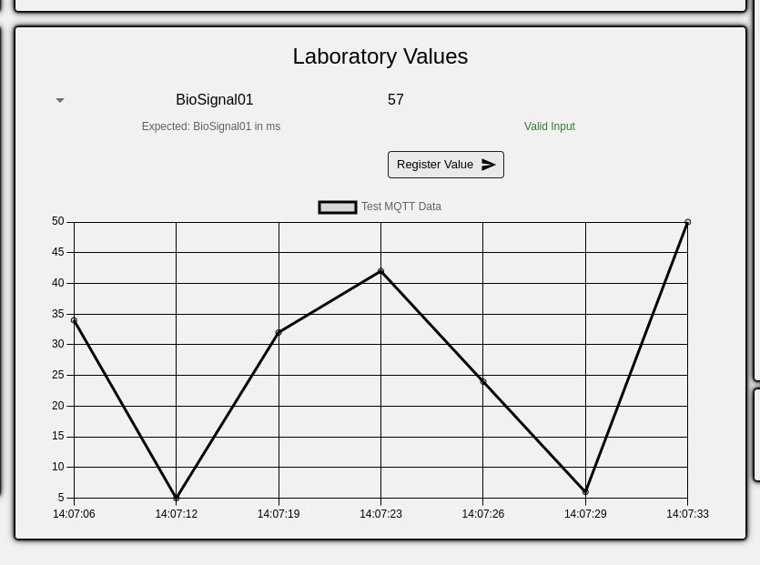
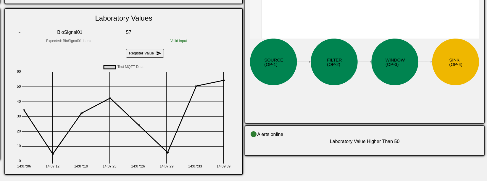
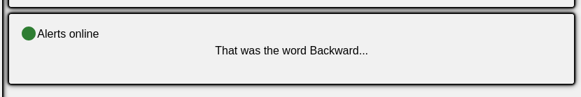

# SIGMOD25 NebulaStream NEEDMI Demo

This repository is an effort to bring all the work for each modality together, and make everything easy-to-run with a few commands.

## Build

Run the prepare script to set environment variables: `./prepare.sh`

## Run

Run the setup with:
```
docker compose up --build --force-recreate
```

## Running the Demo PoC

This Docker Compose runs the following services:

- mqtt-broker: MQTT Broker service, the main communication channel between sources, NebulaStream, sinks, and the Dashboard
- nes: NebulaStream Single Node Worker
- dashboard: The UI to interact with the Demo
- mic-stream: The container capturing the main audio source
- lv-s2s: Laboratory values source-to-sink query, it feeds the Line Plot at the moment
- lv-alert: Laboratory values alert query, activates the alert when a value greater than 50 is submitted
- audio-alert: Takes the audio input and pass it to the speech-to-text model, triggers the alarm when the word "Drawback" is mentioned

### Interacting with the PoC

1. When all the services are up and running, open the default Dashboard URL http://localhost:3000.
2. Use the Laboratory Value input field and click the "Register Value" Button as shown below.
    
    - Laboratory Values can be numeric, either integer or float, positive or negative.
    - The current alert query test if the value is greater than 50, if so, then the alert tuple is emmited. It is expected that a message "Laboratory Value Higher Than 50" appears in the Alert Panel, as shown below.
    
3. The audio source takes the default microphone and once the word "Backward" is mentioned, the alert is triggered. If the word was correctly recognized, then it is expected that a message "That was the word Backward..." appears in the Alert Panel, as shown below.
    
    **Note: Currently the model has false positives, the alert might be triggered despite the word was not the above mentioned.**

## Shutting-down

It is recommended to use `docker compose down` to remove containers before next run.

